<div align="center">

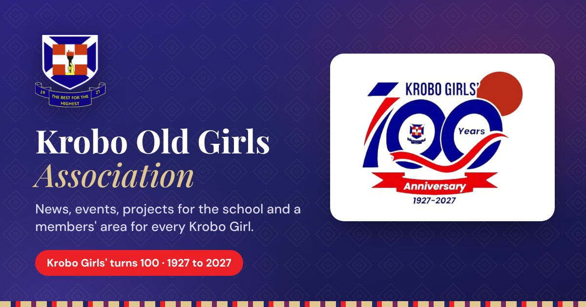

# Krobo Old Girls Association Website

**A modern home for every Krobo Girl: news, events, projects, the Centenary and a members' area.**

[](https://github.com/ABIGAILDEBBY/koga-website/actions/workflows/site-checks.yml)
[](https://abigaildebby.github.io/koga-website/)
[](#project-status)
[](https://abigaildebby.github.io/koga-website/)

[**View the live prototype**](https://abigaildebby.github.io/koga-website/) · [Features](#features) · [Screenshots](#screenshots) · [Roadmap](#roadmap)

</div>

---

## About

The Krobo Old Girls Association (KOGA) is the alumnae body of **Krobo Girls' Presbyterian Senior High School**, Odumase-Krobo, Ghana. The school turns 100 in 2027.

This repository holds a clickable prototype of an official KOGA website. It was designed to solve problems the association runs into every year:

| Problem today | What the website does about it |
| --- | --- |
| Members rarely know what is happening until it is over | One place for news, events, notices and the Centenary programme |
| Elections are hard to verify | Verified voter list, secret ballot and published results |
| Sponsors are hard to find | A private, verified directory of where Old Girls work and how they can help |
| Contributions are hard to track | Open project pages with targets, progress and receipts |
| History lives in scattered WhatsApp chats | A gallery and records archive ahead of the Centenary |

## Features

### Public website

- Homepage with the Centenary countdown and upcoming events
- About, history and the school's motto, *The best for the highest*
- News, events with RSVP, and projects and appeals with progress bars
- Centenary 1927 to 2027 programme
- Gallery, leadership and committees, year groups and contact
- How to join, with clear membership rules

### Members' area

- **Verified directory** of members and Old Girls' businesses, with per-member privacy settings
- **Year group pages** with dues, participation and projects
- **Elections and polls** with a secret ballot and a verified voter list
- **Centenary ambassadors** applications with criteria published up front
- **Jobs, mentoring and celebrations** for the sisterhood
- **Digital membership card** with a QR code for event check-in
- **Admin tools** for verifiers, with classmate vouching and an audit log

### Built for phones first

Most members open links from WhatsApp, so every page is designed for a phone screen first. The link shows a branded preview card when shared.

## Screenshots

<table>
  <tr>
    <td width="50%">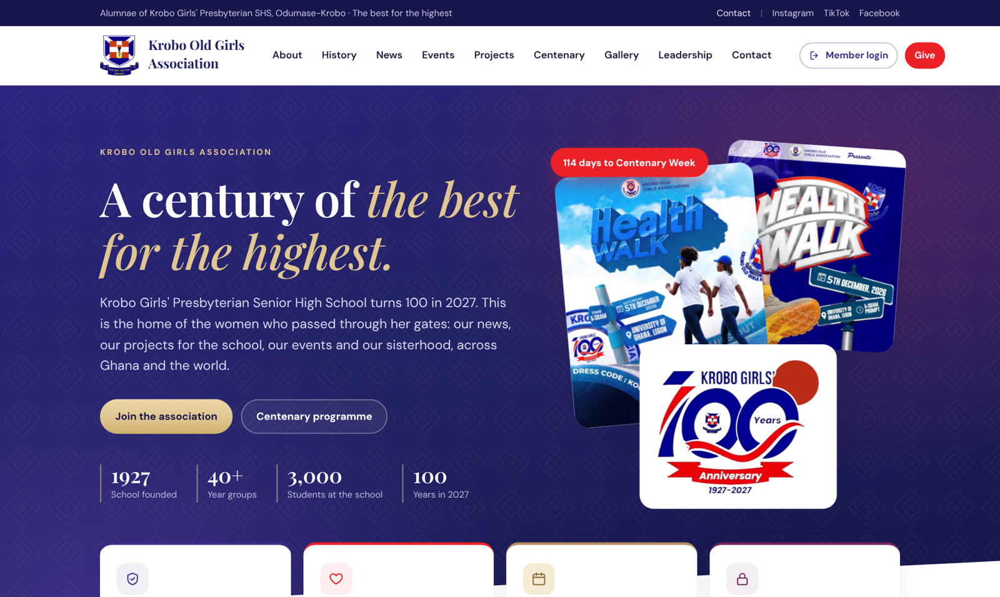<br><sub><b>Homepage</b></sub></td>
    <td width="50%">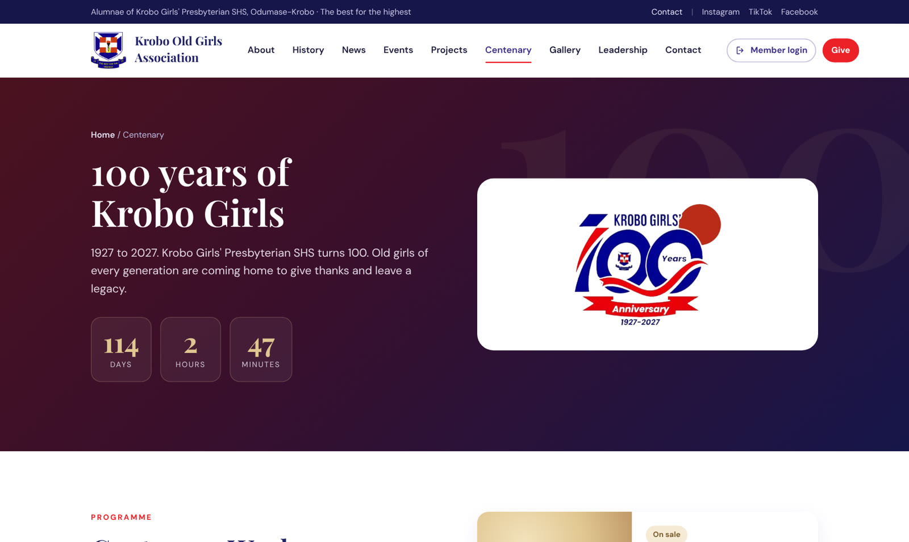<br><sub><b>Centenary 1927 to 2027</b></sub></td>
  </tr>
  <tr>
    <td>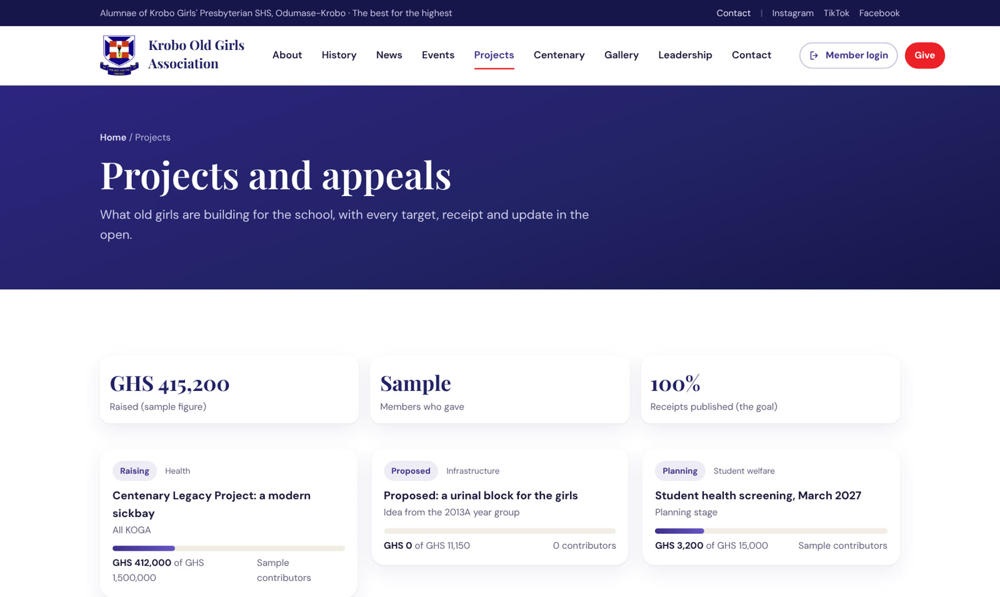<br><sub><b>Projects and appeals</b></sub></td>
    <td>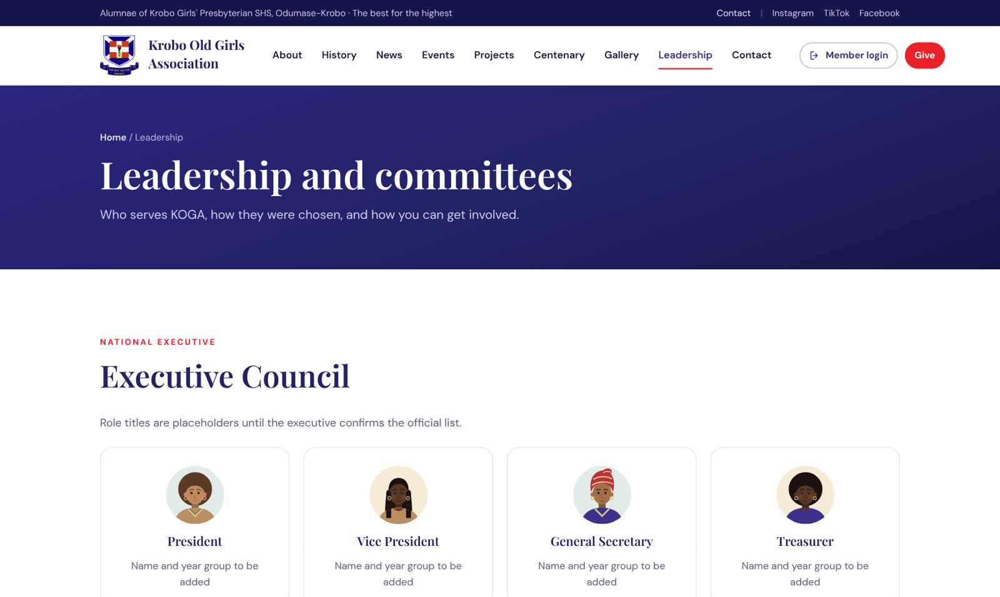<br><sub><b>Leadership and committees</b></sub></td>
  </tr>
  <tr>
    <td>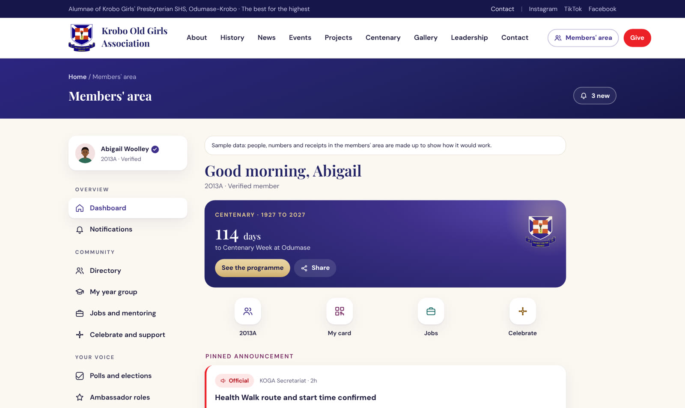<br><sub><b>Members' dashboard</b></sub></td>
    <td>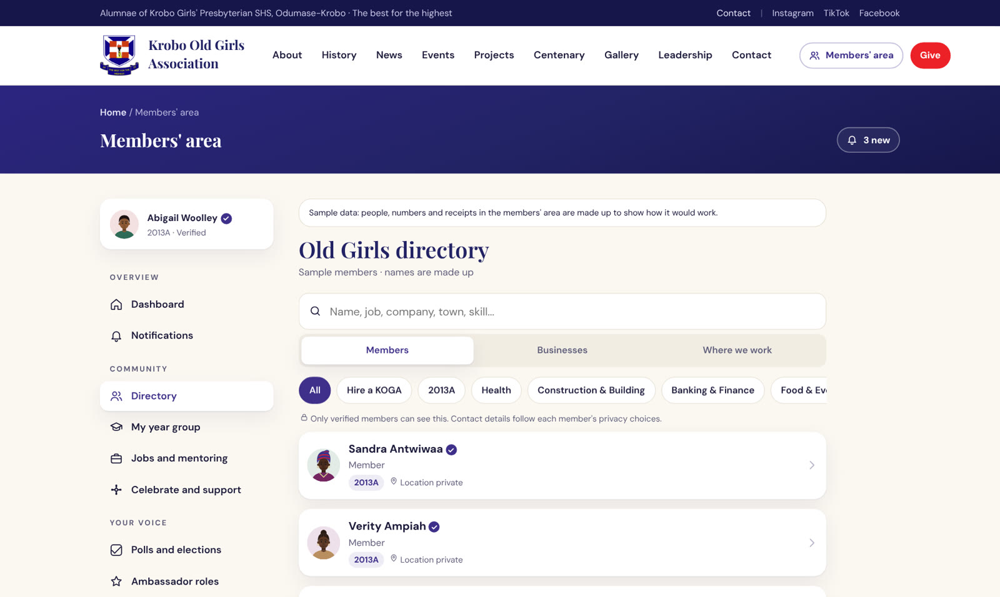<br><sub><b>Verified directory</b></sub></td>
  </tr>
  <tr>
    <td>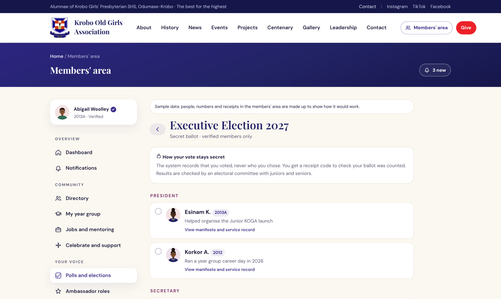<br><sub><b>Secret ballot elections</b></sub></td>
    <td>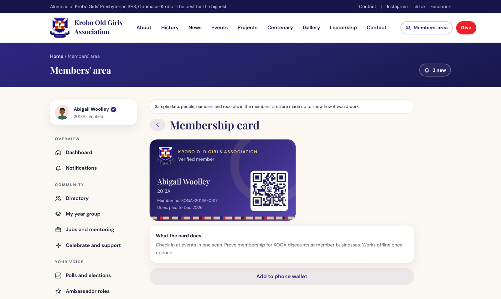<br><sub><b>Digital membership card</b></sub></td>
  </tr>
  <tr>
    <td colspan="2">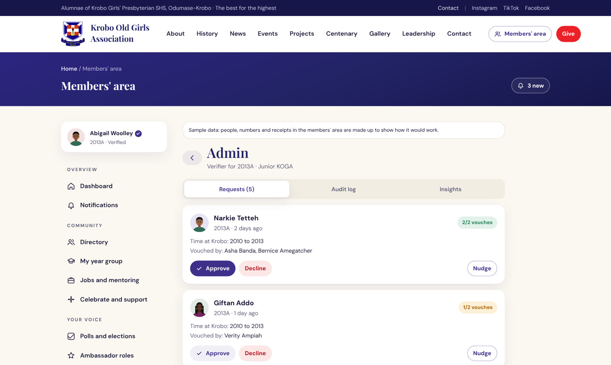<br><sub><b>Admin approvals and vouching</b></sub></td>
  </tr>
</table>

<div align="center">
  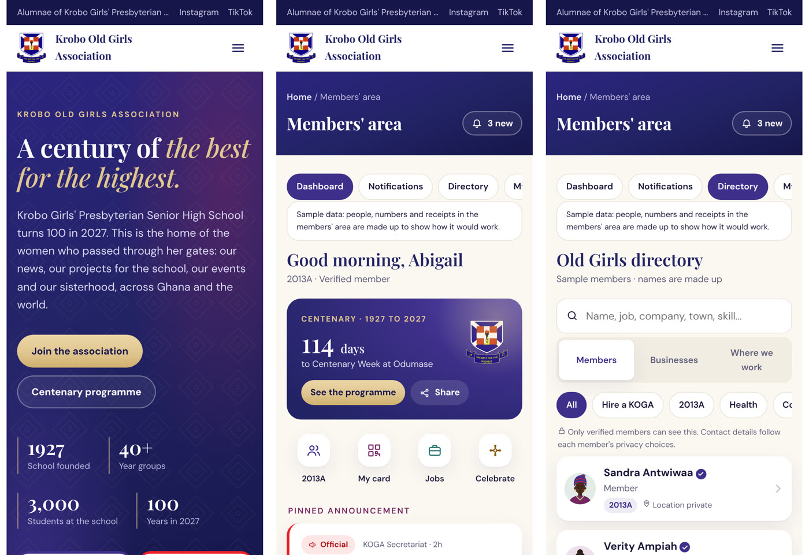<br>
  <sub><b>On the phone</b></sub>
</div>

## Project status

This is a **design prototype**, not the finished product.

- Nothing is saved. Logging in, voting and payments are simulated.
- Event dates, venues and project facts come from KOGA announcements.
- People, money figures and receipts in the members' area are **sample data** and are labelled as such on every page.
- Search engines are asked not to index the site.

## Roadmap

- [x] Clickable prototype of the public site and members' area
- [x] Phone-first layout and WhatsApp link preview
- [x] Automatic checks on every change (GitHub Actions)
- [ ] Feedback from the Junior KOGA executives
- [ ] Official crest, Centenary logo and leadership list from the school and KOGA
- [ ] Full build by a full-stack engineer: real accounts, database, payments and SMS or WhatsApp login
- [ ] Data protection registration with the Ghana Data Protection Commission (Act 843)
- [ ] Optional mobile app

## Repository structure

```
koga-website/
├── index.html                    The whole prototype in one self-contained page
├── koga-link-preview.jpg         Link preview image for WhatsApp and social media (1200 x 630)
├── favicon.ico, favicon-*.png    Browser icons
├── apple-touch-icon.png          Home screen icon for iPhone
├── docs/screenshots/             Images used in this README
└── .github/
    ├── workflows/site-checks.yml Runs the checks on every change
    └── scripts/check_site.py     The checks themselves
```

## Running it locally

No build step and nothing to install. Download the repository and open `index.html` in any browser.

To run the same checks GitHub runs:

```bash
python3 .github/scripts/check_site.py
```

## Automatic checks

Every push runs [Website checks](https://github.com/ABIGAILDEBBY/koga-website/actions/workflows/site-checks.yml). It confirms that required files exist, every local link works, the page stays under 5 MB and the WhatsApp preview tags are present. It then confirms the live site loads.

## Credits

- **Design and product:** Abigail Woolley, Junior KOGA, 2013A
- **Crest:** Krobo Girls' crest from [Wikimedia Commons](https://commons.wikimedia.org/wiki/File:Krobo_Girls_Crest.png) (CC0), with a website watermark removed. To be replaced with the school's official file.
- **Centenary logo:** cropped from an official Centenary flyer until the master file is available.
- **Fonts:** [Playfair Display](https://fonts.google.com/specimen/Playfair+Display) and [DM Sans](https://fonts.google.com/specimen/DM+Sans) from Google Fonts.

The KOGA name, crest and Centenary branding belong to the Krobo Old Girls Association and Krobo Girls' Presbyterian Senior High School.

---

<div align="center">
<sub><i>The best for the highest.</i></sub>
</div>
